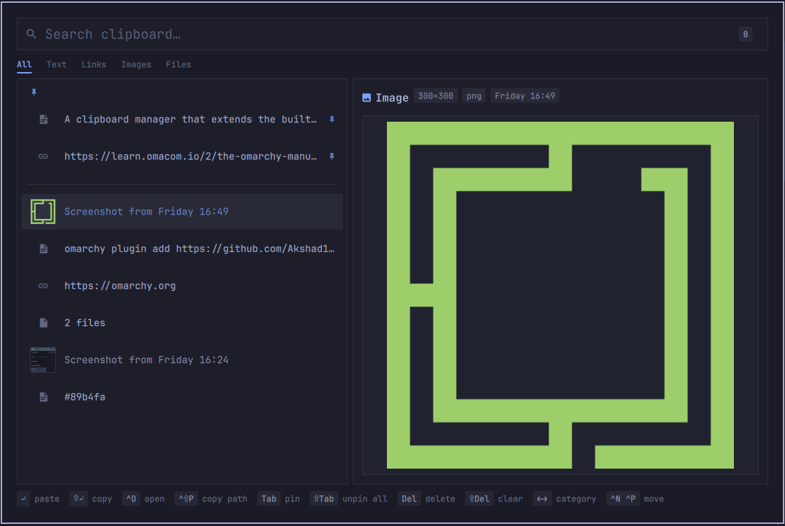

# Clipnest for Omarchy

A native [Omarchy](https://omarchy.org/) clipboard manager that extends the built-in one in place: same history file, same capture flow, same paste scripts, plus pins, category tabs, rich per-type previews, and OCR search over copied images.



## Features

- **Pins:** `Tab` pins an entry. Pins sit in their own section at the top, survive the history cap and clear-all, and plain `Del` never touches them.
- **Category Tabs:** All / Text / Links / Images / Files under the search bar. Cycle with `←` `→` or click.
- **Rich Previews:** Images framed with their dimensions and format, links with their domain and a one-click open, text with character, line, and word counts, file lists one path per row.
- **OCR Search:** The first time an image is previewed, `tesseract` reads its text. The text shows under the image, can be copied, and is searchable from then on.
- **Key-Hint Footer:** Only the keys that apply to the selected entry, so the footer doubles as the manual.
- **Safe Bulk Edits:** Deleting a pin and unpinning everything each ask for confirmation. Clear-all keeps pins.
- **Drop-in Replacement:** Omarchy's own clipboard shortcuts route here while the plugin is enabled; disable it and the built-in is back, history intact.
- **Theme-Integrated:** Colors, spacing, radius, and font come from the active Omarchy theme, so it re-themes with `omarchy theme set`.

---

## Installation

Install and enable the plugin:

```bash
omarchy plugin add https://github.com/Akshad135/clipnest.git --enable
omarchy restart shell
```

Enabling Clipnest disables the built-in `omarchy.clipboard` and routes `Super+Ctrl+V`, plus any binding that targets `omarchy.clipboard`, to Clipnest. Keep the built-in disabled while Clipnest is enabled; both at once means two capture watchers writing the same history file.

---

## Usage & Controls

Open it with Omarchy's clipboard shortcut (`Super+Ctrl+V` by default) or from the command line:

```bash
omarchy-shell shell toggle omarchy.clipboard
```

| Key | Action |
| --- | --- |
| `↑` `↓` / `Ctrl+N` `Ctrl+P` | move |
| `PgUp` `PgDn` / `Home` `End` | jump |
| `←` `→` | switch category |
| `Enter` | copy and paste into the focused window |
| `Shift+Enter` | copy only |
| `Ctrl+O` / `Alt+Enter` | open: images in the viewer, text that contains a URL in the browser, other text in the editor |
| `Ctrl+Shift+P` | copy the file path (images and files) |
| `Ctrl+Shift+C` | copy as plain text; for images, the OCR text |
| `Tab` | pin / unpin |
| `Shift+Tab` | unpin all (confirms) |
| `Del` | delete; does nothing on a pin |
| `Ctrl+Del` | delete a pinned entry (confirms) |
| `Shift+Del` | clear history, keeping pins (confirms) |
| `Ctrl+U` | clear the search |
| `Esc` | clear the search, then close |

Mouse: click a row to select it, click it again to paste. The preview pane has clickable chips for opening a link and copying OCR text.

---

## Configuration

There are no settings. History keeps the latest 500 entries plus every pin, and the picker shows up to 50 unpinned matches at a time.

---

## Uninstallation

To disable or remove the plugin:

```bash
omarchy plugin disable akshad135.clipnest
omarchy plugin remove akshad135.clipnest
```

Disabling restores the built-in clipboard. History is kept; only the pins are forgotten, since the built-in does not know about them.

---

## Dependencies & Requirements

- `omarchy` / `quickshell` (shell framework)
- `wl-clipboard` (`wl-paste` watcher and `wl-copy`)
- `jq`, `wtype` (used by Omarchy's own paste scripts)
- `imagemagick` (`magick identify`, verifies each image and reads its dimensions; OCR only runs on images it accepts, so without it there is no dimensions chip and no OCR)
- `tesseract` with a language pack, optional (`omarchy pkg add tesseract tesseract-data-eng`); without it images simply have no text panel

Everything except `tesseract` is part of Omarchy's base install. No sudo or pkexec is required.

---

## Architecture & Security

- **Network:** None. The plugin never makes a network request. Opening a link hands the URL to Omarchy's browser launcher, and only on an explicit keypress or click.
- **Execution:** All child processes use structured argument arrays via Quickshell `Process`, no shell string interpolation. Clipboard text is written to `wl-copy` over stdin, never passed as a process argument, so it does not show up in process listings visible to other local accounts.
- **Capture Boundary:** Capture uses Omarchy's own `capture.sh`, unchanged: every read of the clipboard owner is bounded by a timeout, password-manager clips (`x-kde-passwordManagerHint`) are skipped, and images are stored content-addressed by SHA-256.
- **Image Handling:** Previews and thumbnails keep only a bitmap of roughly their drawn size, never the file's own size. `tesseract` and `magick` are only ever given files inside Omarchy's content-addressed image store, and OCR runs only after `identify -ping` (header only, decoder forced from the file extension, 5-second deadline) confirms the file is a real PNG, JPEG, WebP, GIF, BMP, or TIFF, because tesseract treats undecodable input as a list of image paths to read. OCR skips images over 40 megapixels and runs under a 20-second deadline and a 2 GB address-space limit (`prlimit`), since the decoded bitmap can be far larger than the file; a failed run is not persisted.
- **Privilege Boundary:** Runs entirely as an unprivileged user process. The two clipboard watchers are tied to the shell's lifetime with `pdeathsig`; nothing is installed or left running outside the shell.
- **State Storage:** History lives in `~/.local/state/omarchy/clipboard-history.json` (fixed path, like Omarchy's own scripts; `XDG_STATE_HOME` is not consulted), the same file the built-in uses, with image blobs under `~/.local/state/omarchy/clipboard-images/`. Clipnest adds two optional fields per entry, `pinned` and `ocr`; Omarchy's scripts ignore both.

---

## Testing

Run the logic tests (requires `node`):

```bash
tests/run.sh
```

For UI changes, edit the files, then `omarchy restart shell` (the shell caches plugin QML) and check `journalctl --user` for QML warnings.

---

## License

[MIT](LICENSE) © [Akshad Agrawal](https://github.com/Akshad135)

Built on the clipboard plugin that ships with [Omarchy](https://omarchy.org), used under its MIT license.
